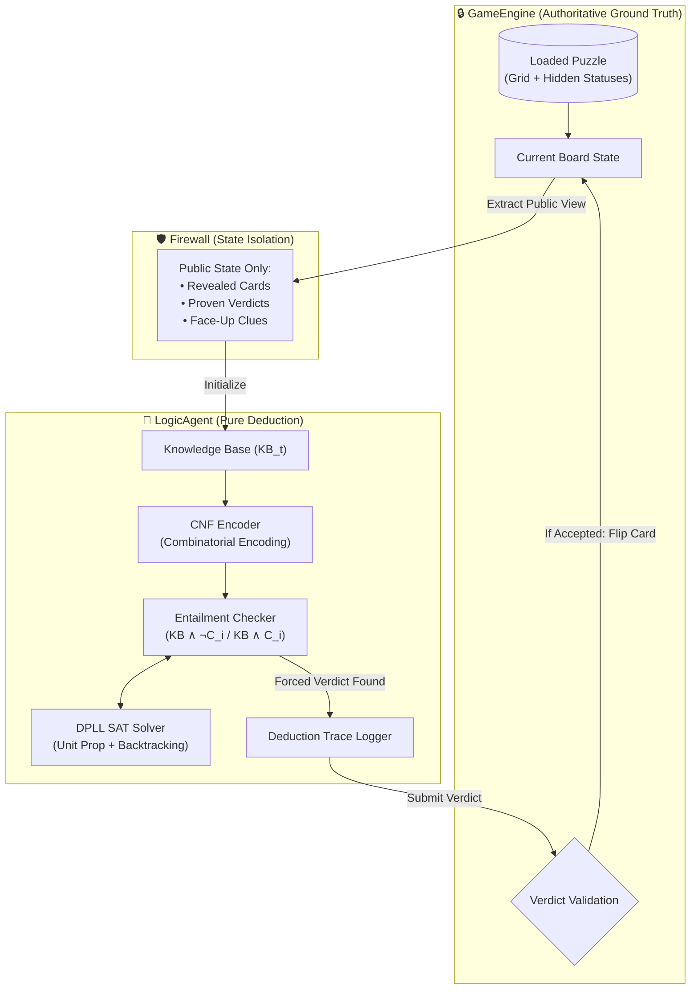
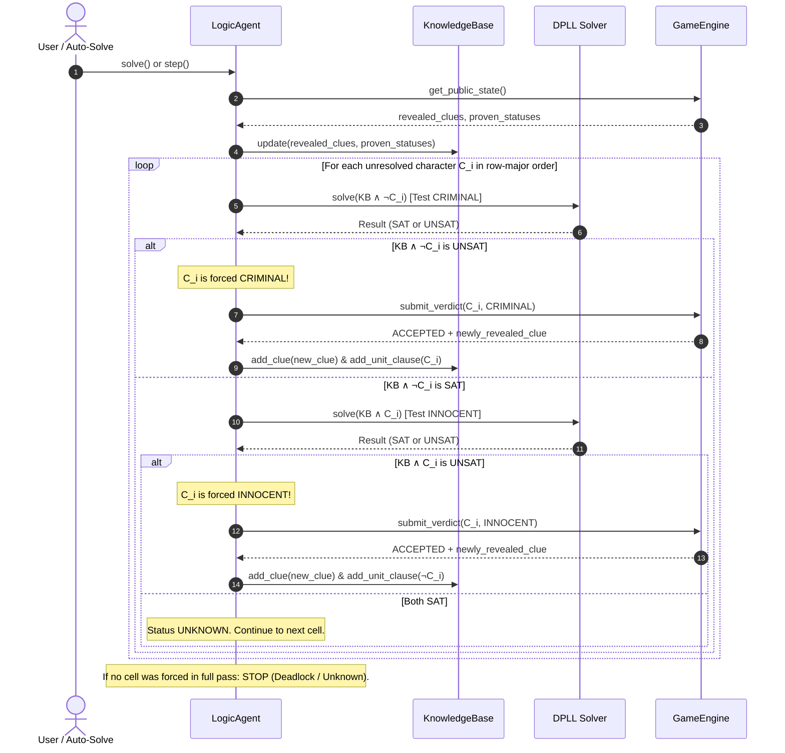
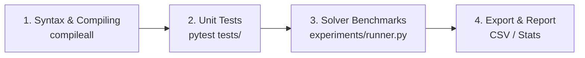

# ⚙️ Griductive Solver: Engineering & Deduction Pipeline

This document outlines the two core pipelines in the project:
1. **The Deduction Pipeline**: How clues, propositional logic, and DPLL interact to solve a puzzle with zero guessing.
2. **The Software Quality & CI/CD Pipeline**: Automated verification, unit testing, and benchmark generation.

---

## 1. 🧩 The Griductive Deduction Pipeline

The deduction loop operates strictly under the **Open World Assumption** from the agent's perspective: an unrevealed card carries unknown truth until logically forced by public clues.

### Architecture & Security Boundary (The Firewall)



---

### Step-by-Step Deduction Protocol



---

## 2. 🔬 Logical Entailment Mathematics

For any unresolved character $i$ at deduction step $t$:

$$\text{KB}_t \models C_i \iff \text{KB}_t \land \neg C_i \text{ is } \mathbf{UNSAT} \implies \text{Verdict: } \mathbf{CRIMINAL}$$

$$\text{KB}_t \models \neg C_i \iff \text{KB}_t \land C_i \text{ is } \mathbf{UNSAT} \implies \text{Verdict: } \mathbf{INNOCENT}$$

$$\text{Both } \text{KB}_t \land \neg C_i \text{ and } \text{KB}_t \land C_i \text{ are SAT} \implies \text{Verdict: } \mathbf{UNKNOWN} \text{ (Never Guess)}$$

$$\text{Both } \text{KB}_t \land \neg C_i \text{ and } \text{KB}_t \land C_i \text{ are UNSAT} \implies \text{Verdict: } \mathbf{INCONSISTENT}$$

---

## 3. 🧪 Software Quality & CI/CD Pipeline

We enforce a strict 4-stage pipeline for all code contributions:



### Stage 1: Syntax & Bytecode Compilation
Ensures no syntax errors, broken imports, or missing packages:
```bash
python3 -m compileall Source/
```

### Stage 2: Unit Testing Suite
Runs all test modules with verbose output:
```bash
pytest Source/tests/ -v
```

### Stage 3: Benchmark Suite (3×3, 4×4, 5×5)
Runs the experiment runner across all puzzle sizes and collects metrics:
```bash
python3 Source/main.py --experiment Source/puzzles/
```

### Stage 4: Automated Verification Script
Run the automated pipeline script in one step:
```bash
./scripts/pipeline.sh
```
